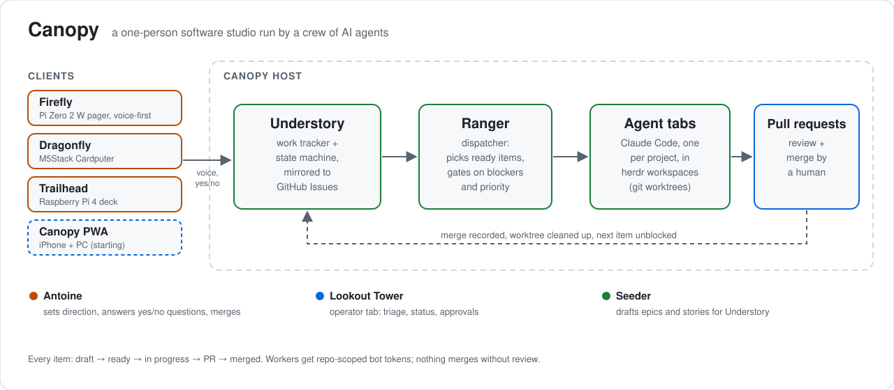
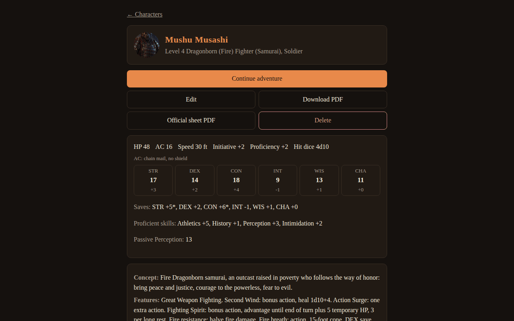
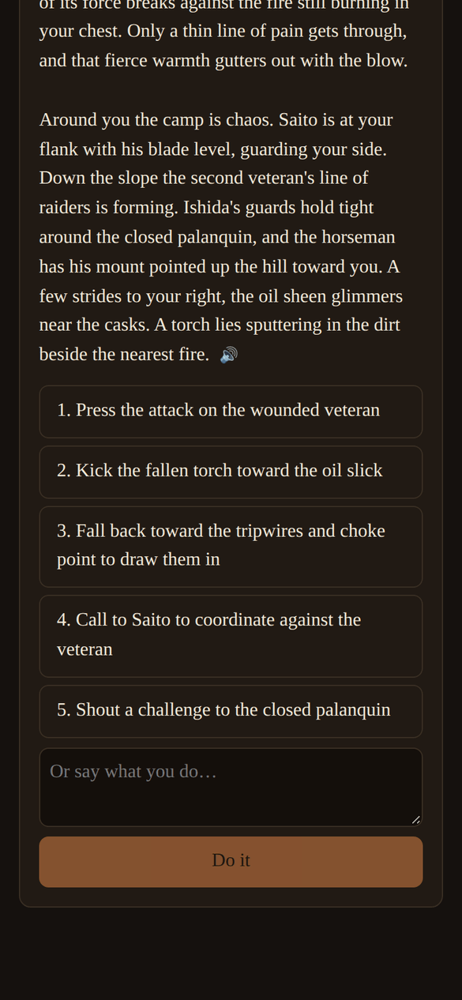
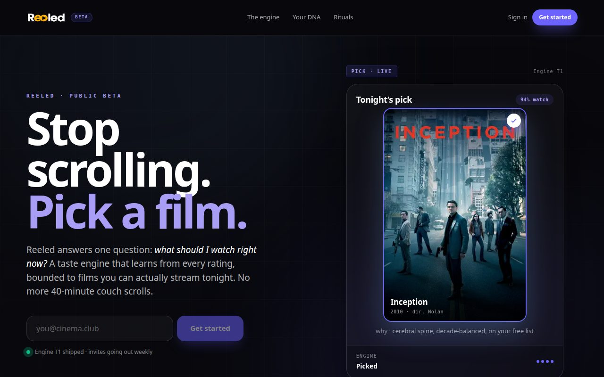
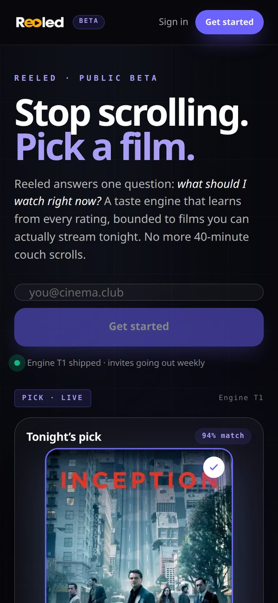
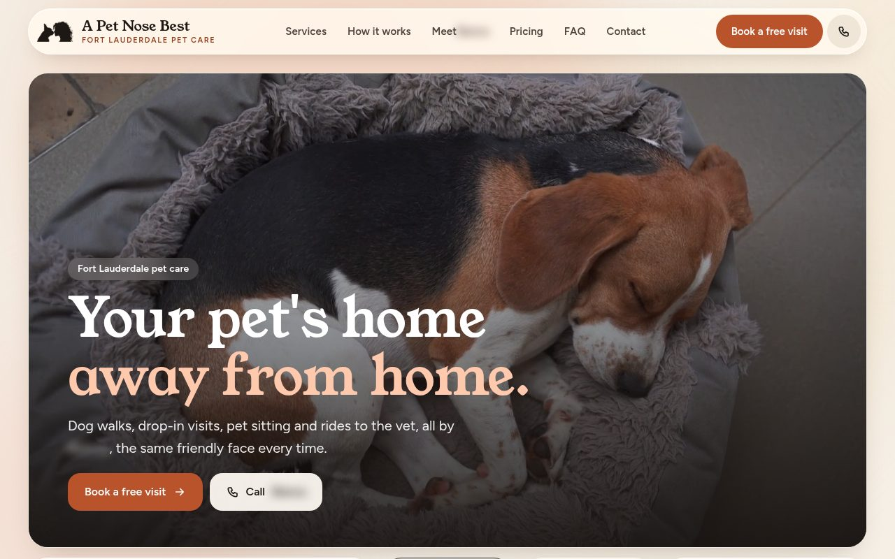
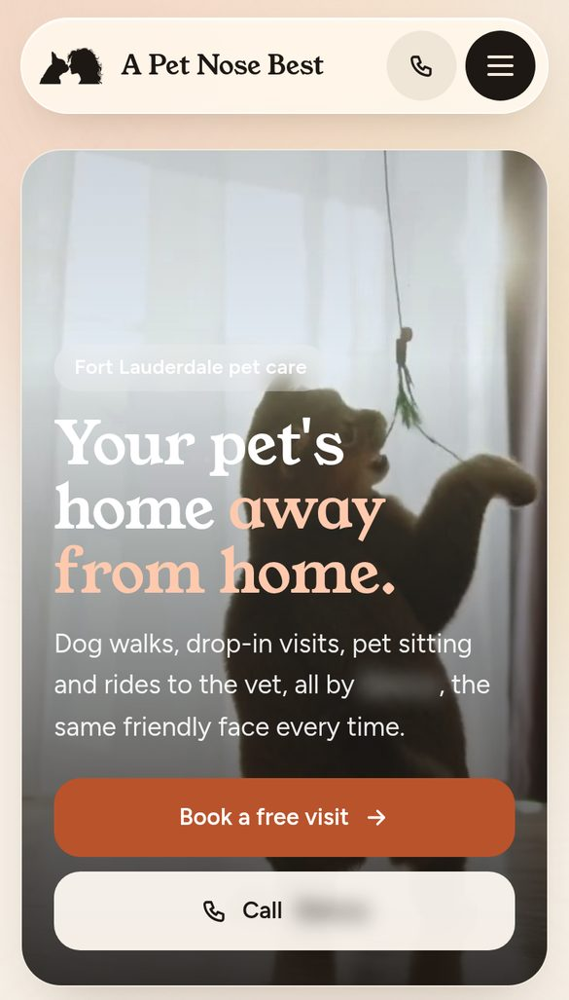
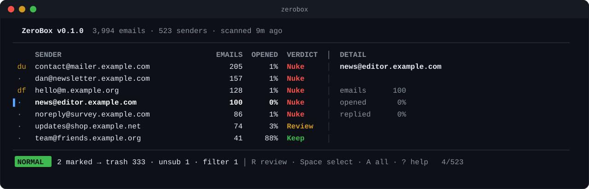

# 👋 Hey, I'm Antoine Gaton

Software engineer building at the intersection of full-stack development, AI workflows, and developer tooling. By day I'm a **Software Engineer at SBS CyberSecurity**. By night and weekend, I run **Code Monkey Studios**, where I ship SaaS products, AI-powered tools, and the occasional thing built purely because it sounded fun.

I care about software that feels both powerful and human. Clean architecture under the hood, polished experience on top.

> **Need a site or app built?** → [Code Monkey Studios](https://bio.site/code_monkey.studios)

- 💼 Software Engineer at SBS CyberSecurity
- 🛠️ Founder & sole dev of **Code Monkey Studios**
- 🧠 Designing multi-agent AI workflows and developer productivity tools
- 📍 Based in Fort Lauderdale, FL

---

## 🎬 Featured Projects

### Canopy

<picture>
  <source media="(prefers-color-scheme: dark)" srcset="assets/canopy-dark.svg">
  
</picture>

The multi-agent system that runs Code Monkey Studios. **Understory** mirrors GitHub Issues into a state machine, **Ranger** dispatches ready work, and a Claude Code agent per project works in its own herdr workspace until a pull request is ready for review. I steer it from anywhere: **Firefly** (a voice-first Pi Zero 2 W pager), **Dragonfly** (an M5Stack Cardputer), and **Trailhead** (a Raspberry Pi 4 deck), with a Canopy PWA for iPhone and PC on the way.

### Campfire

  
  

A personal AI Dungeon Master. Build a character, keep a living character sheet, roll digital or physical dice, and play adventures where the world remembers what you did. The server owns the dice and the persistent world state; the AI only proposes. Next.js + Postgres.

### Reeled

  
  

A decision engine for "what should I watch right now," built for people whose watchlists have become graveyards. Integrates TMDB, Trakt, and personal ratings into a recommendation experience that feels like a friend handing you the remote. The core moat is the **Movie DNA Engine**, a recommendation algorithm I'm developing across a three-tier roadmap.

### FetchFlow

  
  

A white-label B2B SaaS platform for pet care businesses: dog walkers, pet sitters, transportation services. Booking, scheduling, staff and client portals, payments, and AI-assisted workflows, all customizable per tenant. First tenant: **A Pet Nose Best**, shown above.

### [zerobox-cli](https://github.com/AntoineGaton/zerobox-cli)

Clean your Gmail from the terminal. ZeroBox ranks every sender in your inbox, then trashes, unsubscribes and filters the noisy ones in bulk. It runs on your machine, with no ZeroBox server. Open source: `npx zerobox-cli`.

---

## 🧰 Stack

  

TypeScript · Python · Next.js · React · Tailwind · shadcn/ui · Node.js · FastAPI · PostgreSQL · Supabase · Vercel · Docker · GitHub Actions · Claude Code / Anthropic API · Raspberry Pi

---

## 💼 Experience

**Software Engineer, SBS CyberSecurity**
Build and maintain full-stack applications and APIs, improve internal developer workflows, work across cloud infrastructure and modern pipelines, and help drive AI adoption and tooling initiatives across Agile teams.

**Founder & Lead Developer, Code Monkey Studios**
Ship SaaS products, automation systems, and AI-powered tools across both client work and personal ventures. Operate end-to-end as product owner, designer, and developer.

**Teaching Assistant, Coding Dojo**
Mentored students across multiple languages and frameworks, helping aspiring developers build technical foundations and the confidence to use them.

<!-- TODO: SBS CyberSecurity LinkedIn shout-outs -->

### ✍️ Writing

- [Developer's Guide to AI Workflows and Prompting for Security and Compliance](https://sbscyber.com/blog/ai-prompting-for-security-compliance) (SBS CyberSecurity)
- [More posts →](https://sbscyber.com/blog/author/antoine-gaton)

---

## 💡 What I Value

Clean code that someone else can actually maintain. Shipping real things instead of endlessly planning them. Collaboration and mentorship. Building products that genuinely help people. Continuous learning without losing the joy in it.

---

## 📫 Let's Connect

Always interested in meaningful software, ambitious ideas, AI and automation projects, SaaS products, developer tooling, and open-source contributions.

- 💼 LinkedIn: [linkedin.com/in/antoinegaton](https://linkedin.com/in/antoinegaton)
- 🌐 Portfolio: [antoinegaton.com](https://antoinegaton.com)
- 🐒 Code Monkey Studios: [bio.site/code_monkey.studios](https://bio.site/code_monkey.studios) · [LinkedIn](https://linkedin.com/company/code-monkey-studios-llc)
- ✉️ Email: [codemonkeystudios@proton.me](mailto:codemonkeystudios@proton.me)

Thanks for stopping by 🚀
